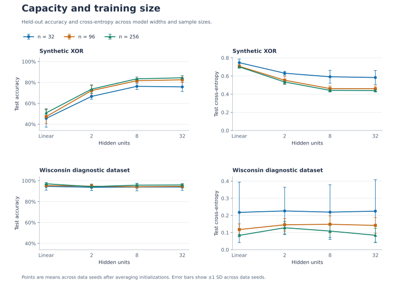
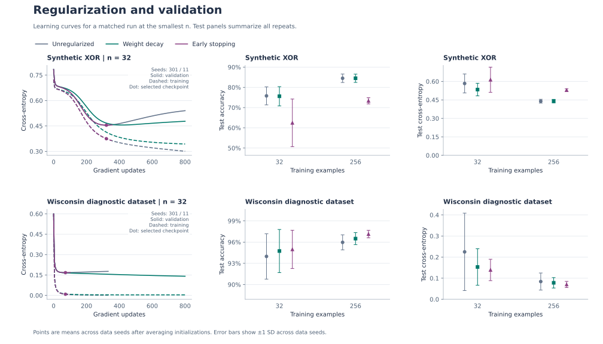
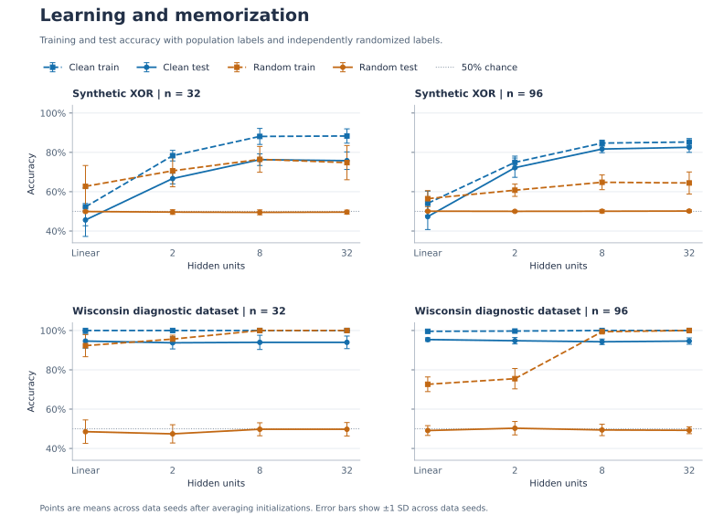
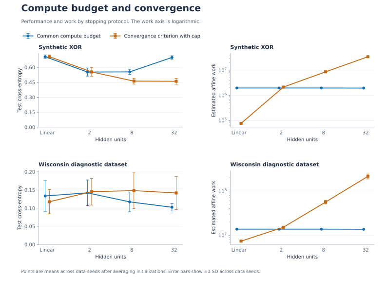
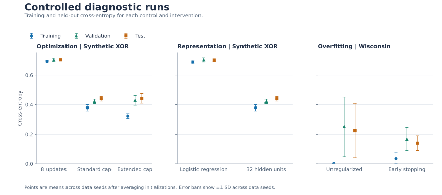

# Neural-network capacity and generalization

MAC 312 · Project 9

On noisy XOR with 256 training examples, the width-32 network reached **84.5% mean test accuracy** and **0.440 test cross-entropy**. Logistic regression reached **50.9%** and **0.700**. On the Wisconsin Diagnostic Breast Cancer dataset (WDBC) at the same sample size, logistic regression reached **97.1%**, versus **96.0%** for the unregularized width-32 network. Under independently randomized WDBC labels, the width-32 model fit every training label at both tested sample sizes while held-out accuracy stayed near 50%. Three matched comparisons separate the causes of a poor fit. Too few updates explain the short noisy-XOR run. A linear model class limits noisy XOR even when it converges. Overfitting shows up on WDBC, where validation-based stopping lowers test loss while training loss rises.

## Model and derivation

Let $X\in\mathbb{R}^{n\times d}$ be the standardized features, $y\in\{0,1\}^n$ the labels, and $m$ the hidden width. With $\mathbf1$ the vector of ones, the forward model is

$$
A=XW_1+\mathbf1 b_1^\top,\qquad H=\tanh(A),\qquad
z=Hw_2+b_2\mathbf1,\qquad
Y_i\mid x_i\sim\operatorname{Bernoulli}(\sigma(z_i)).
$$

Here $W_1\in\mathbb{R}^{d\times m}$, $b_1,w_2\in\mathbb{R}^m$, $b_2$ is a scalar, and $\sigma(z)=(1+e^{-z})^{-1}$. The logistic baseline uses $z=Xw+b\mathbf1$. Both classify as 1 at probabilities of at least 0.5. For each model, the mean Bernoulli negative log-likelihood with optional L2 weight decay is

$$
J=\frac1n\sum_{i=1}^n \operatorname{softplus}((1-2y_i)z_i)
  +\frac{\lambda}{2}\sum_{W\text{ a weight array}}\lVert W\rVert_F^2 .
$$

The loss follows by taking the negative log of $p_i^{y_i}(1-p_i)^{1-y_i}$. Biases are unpenalized. The implementation evaluates softplus $\log(1+e^u)$ with NumPy's stable `logaddexp(0, u)`. It obtains the logit derivative via the stable identity $-\operatorname{expm1}(-\operatorname{softplus}(u))=\sigma(u)$.

Differentiating the mean data loss gives $\delta=(\sigma(z)-y)/n$. Backpropagating through $\tanh$ gives $G=(\delta w_2^\top)\odot(1-H\odot H)$, where $\odot$ is elementwise multiplication. The gradients are

$$
\nabla_{w_2}J=H^\top\delta+\lambda w_2,\qquad
\nabla_{b_2}J=\mathbf1^\top\delta,\qquad
\nabla_{W_1}J=X^\top G+\lambda W_1,\qquad
\nabla_{b_1}J=G^\top\mathbf1 .
$$

For logistic regression, $\nabla_w J=X^\top\delta+\lambda w$ and $\nabla_b J=\mathbf1^\top\delta$. Full-batch gradient descent updates every parameter by subtracting $0.2$ times its gradient. We initialize weights with Glorot uniform draws and biases at zero. On a seven-example, three-feature problem, central differences with $\epsilon=10^{-5}$ checked all 4 logistic parameters and all 21 width-4 network parameters with both $\lambda=0$ and $\lambda=0.05$. The worst absolute gradient error was $1.06\times10^{-11}$ against a $10^{-7}$ tolerance. See the [numerical checks](results/protocol.json).

## Experimental protocol

| Dataset | Features and target | Training reservoir / validation / test |
|---|---|---:|
| Noisy XOR | Two uniform features in $[-1,1]$. The label is 1 for opposite signs, with independent 10% label flips. Bayes accuracy is 90%. | 4,096 / 256 / 2,048 |
| WDBC | All 30 scikit-learn numeric features, with malignant mapped to 1. The initial split is stratified. | 341 / 114 / 114 |

Five data seeds give five random permutations of each training reservoir. Training sizes 32, 96 and 256 are nested prefixes within a data seed. Three initialization seeds are crossed with each data seed, giving 15 runs per condition. Related experiments reuse the same examples and initialization seed. Each subset is standardized using its own training means and standard deviations. The features and labels in the fixed validation and test pools are held out from training. Test scores are computed after each run's model or hyperparameter selection. The [data notes](data/README.md) document provenance and the code maps results to specific seeds.

The primary sweep compares logistic regression and widths 2, 8 and 32. Accuracy uses a probability threshold of 0.5. Reported losses are unpenalized mean binary cross-entropy on each split. Tables report means across 15 runs. Figure error bars show one sample standard deviation across the five data-seed means after averaging over initializations. These describe variability under the chosen splits and seeds. They are not confidence intervals for new validation or test populations.

Unregularized and weight-decay fits use a training-objective gradient norm threshold of 0.005 with an 800-update cap. Fits at the cap are labeled accordingly. Per run, weight decay chooses $\lambda\in\{0.0005,0.005,0.05\}$ by minimum validation cross-entropy at the candidate terminal iterate. Early stopping checks validation loss at initialization and after every update. An improvement greater than $0.0002$ resets the 35-check patience counter. At patience expiry or the shared 800-update cap, the earliest checkpoint with the lowest observed validation loss is restored. The norm rule is disabled for early stopping so its stopping decision follows the validation trajectory. The saved curves contain every fifth checkpoint and the terminal checkpoint.

## Capacity and training set size

| Dataset | Training size | Logistic test accuracy / loss | Width 8 | Width 32 |
|---|---:|---:|---:|---:|
| Noisy XOR | 32 | 45.6% / 0.747 | 76.3% / 0.591 | 75.8% / 0.583 |
| Noisy XOR | 96 | 47.3% / 0.706 | 81.7% / 0.462 | 82.6% / 0.460 |
| Noisy XOR | 256 | 50.9% / 0.700 | 83.5% / 0.442 | 84.5% / 0.440 |
| WDBC | 32 | 94.6% / 0.218 | 94.0% / 0.219 | 94.0% / 0.225 |
| WDBC | 96 | 95.4% / 0.118 | 94.3% / 0.148 | 94.6% / 0.142 |
| WDBC | 256 | 97.1% / 0.084 | 95.8% / 0.109 | 96.0% / 0.084 |

On XOR at $n=256$, moving from 2 to 8 hidden units increased accuracy from 73.6% to 83.5%. Moving from 8 to 32 added about one percentage point. Holding width 32 fixed, expanding the training set from 32 to 256 examples raised mean accuracy by 8.7 percentage points and cut mean cross-entropy by 0.144. The lower cross-entropy at width 32 than width 8 at $n=32$ coexists with slightly lower accuracy because cross-entropy also evaluates the assigned probabilities. On WDBC the linear baseline already separates most held-out cases, and higher width under this unregularized protocol adds no consistent test gain.

## Regularization

| Dataset | Training size | Unregularized test loss | Weight decay | Early stopping |
|---|---:|---:|---:|---:|
| Noisy XOR | 32 | 0.583 | **0.534** | 0.613 |
| Noisy XOR | 256 | 0.440 | 0.440 | 0.530 |
| WDBC | 32 | 0.225 | 0.153 | **0.139** |
| WDBC | 256 | 0.084 | 0.078 | **0.070** |

At small sample size on XOR, every weight-decay run selected $\lambda=0.005$. Mean held-out accuracy was 75.6%, close to unregularized accuracy of 75.8%, while probability loss fell by 0.049. Early stopping on the same task chose an average of 144 updates at $n=32$, and its mean training and test losses were both higher than those at the terminal unregularized iterate. The validation plateau under this patience setting sometimes preceded learning the nonlinear boundary. On WDBC with 32 examples, both methods improved mean test loss and early stopping increased mean accuracy from 94.0% to 95.0%. The figure pairs curves from the same data and initialization seed within each setting to illustrate individual training paths alongside the multi-run test summaries.

## Random-label control

The random controls keep the same features, sample memberships, and initial weights. Training, validation, and test labels are drawn independently from $\operatorname{Bernoulli}(0.5)$ using separate streams. Each data seed fixes one draw per split for all paired model comparisons. Under this null, expected test accuracy is 50% because predictions cannot depend on independent test labels.

| Dataset | Training size | Width-32 random-label train accuracy | Random-label test accuracy | Random-label test loss |
|---|---:|---:|---:|---:|
| Noisy XOR | 32 | 74.8% | 49.6% | 1.009 |
| Noisy XOR | 96 | 64.4% | 50.2% | 0.741 |
| WDBC | 32 | 100.0% | 49.8% | 2.470 |
| WDBC | 96 | 100.0% | 49.2% | 1.661 |

The real-data feature matrix supported complete memorization at these sizes under the implemented width-32 training regime. At $n=32$, logistic regression on the same randomized WDBC data fit 92.3% of assignments, which is plausible with 30 input features and a bias. The random-label test loss of 2.470 for the width-32 model is far above the $\log 2\approx0.693$ loss of predicting 0.5. It assigns confident probabilities to outcomes independent of the inputs. On the two-dimensional synthetic features, the same width and optimizer only partially fit random labels within the cap. The control measures achieved fit under each protocol, so it cannot establish the maximum number of arbitrary labels any architecture could fit.

The [random-label audit](RANDOM_LABELS.md) confirms that the drawn labels are independent of the features and across splits. Under this construction, each run's test accuracy follows an exact Binomial$(n_{\text{test}},0.5)$ null, and 229 of the 240 random-label runs fall inside its central 95% interval.

## Compute budgets and controlled diagnoses

At $n=96$ for each dataset, one checkpoint includes a full training forward and gradient pass plus one validation forward pass. The affine multiply-accumulate count per checkpoint is $(2n+n_v)d$ for logistic regression and $(2n+n_v)m(d+1)$ for the network, where $n_v$ is validation size. This counts the matrix/vector contractions for both affine layers and their weight gradients. Biases, elementwise operations, logging, final scoring and data prep are excluded. This is an architecture-sensitive compute proxy, not elapsed time.

The common ceiling is 181 checkpoints of width 8 on the same dataset, or 1,946,112 affine terms on XOR and 13,735,728 on WDBC. Each model takes the largest integer number of full updates whose checkpoints fit, counting both the initial and terminal checkpoint. Width 32 thus receives 44 updates, width 8 receives 180, and width 2 gets 723. Logistic regression is much cheaper per update, so the same ceiling gives it 2,171 updates on XOR and 1,495 on WDBC. That is more than the 800-update cap of the other rule. The other regime uses the gradient norm and 800-update cap defined above.

Despite its name, the second rule seldom reaches convergence for the networks. On XOR, widths 8 and 32 stopped at the cap in all 15 runs, with mean terminal gradient norms of 0.016 and 0.017 against the 0.005 threshold. Width 2 stopped at the cap in 13 of 15 runs. Only logistic regression converged on XOR (all 15 runs, after 83 updates on average). On WDBC, 6 of 15 runs at widths 8 and 32 and 13 of 15 at width 2 reached the cap, as did all 15 logistic runs. For the networks on XOR, this regime is therefore a fixed 800-update budget, not a convergence criterion. Its compute is 1.1 times the common ceiling at width 2, 4.4 times at width 8 and 17.7 times at width 32. On WDBC the corresponding ratios are 1.1, 4.1 and 15.7, while logistic regression uses 0.54 times the ceiling.

| Dataset | Width | Fixed budget: updates, test accuracy / loss | Gradient rule with cap: updates, test accuracy / loss |
|---|---:|---|---|
| Noisy XOR | Logistic | 2,171, 47.3% / 0.707 | 83, 47.3% / 0.706 |
| Noisy XOR | 2 | 723, 72.2% / 0.553 | 788, 72.2% / 0.554 |
| Noisy XOR | 8 | 180, 74.6% / 0.554 | 800, 81.7% / 0.462 |
| Noisy XOR | 32 | 44, 49.4% / 0.699 | 800, 82.6% / 0.460 |
| WDBC | Logistic | 1,495, 94.7% / 0.134 | 800, 95.4% / 0.118 |
| WDBC | 2 | 723, 94.9% / 0.142 | 798, 94.8% / 0.145 |
| WDBC | 8 | 180, 95.4% / 0.117 | 743, 94.3% / 0.148 |
| WDBC | 32 | 44, 96.4% / 0.102 | 710, 94.6% / 0.142 |

Update counts under the gradient rule are means over 15 runs.

The two datasets respond to the budget in opposite ways. On XOR at equal compute, width 32 is the worst network because 44 updates leave it near its initial loss of about 0.7. Width 8, with 180 updates, reaches 74.6%. A wider network needs more updates here, so its larger per-update cost offsets any extra capacity. Under the longer rule, width 32 reaches 82.6%, a gain of about one point over width 8. On WDBC, the fixed budget gives width 32 its best result (96.4% accuracy, 0.102 test loss). Its training loss is 0.069 at that point, against 0.004 under the longer rule, and its test loss is lower. Stopping early is likely acting as implicit regularization, and the regularization section shows the same effect with explicit validation-based stopping. The WDBC gaps are about two points of accuracy, or about two of the 114 test cases, so they are suggestive, not firm. Extra training lowers training loss on both datasets. It hurt held-out loss only on WDBC.

| Diagnosis | Controlled change | Mean training loss | Mean validation loss | Mean test loss |
|---|---|---:|---:|---:|
| Optimization, XOR with $n=256$ | Same width 32, seed, learning rate and data. Increase allowance from 8 to 800 updates. | 0.689 → 0.379 | 0.701 → 0.422 | 0.702 → 0.440 |
| Optimization, continued | Same runs, 800 → 3,000 updates under the same gradient rule. | 0.379 → 0.323 | 0.422 → 0.429 | 0.440 → 0.443 |
| Representation, XOR with $n=256$ | Replace the linear model with width 32 and use the same gradient rule and 800-update cap. | 0.687 → 0.379 | 0.701 → 0.422 | 0.700 → 0.440 |
| Overfitting, WDBC with $n=32$ | Same width 32 and starting weights. Use the validation-selected checkpoint. | 0.002 → 0.035 | 0.250 → 0.166 | 0.225 → 0.139 |

Optimization. Width 32 trained for 8 updates sits at the initial loss of about 0.7, and 800 updates lower test loss to 0.440 with the same model, data and seed. The budget comparison above shows the same effect at 44 updates (49.4% accuracy) versus 800 (82.6%). The 8-update run is a deliberately short control, so these two contrasts together show that too few updates hurt a model that can fit this task. The 800-update fit still has a mean terminal gradient norm of 0.0168, so we also trained the same runs for 3,000 updates. Training loss kept falling from 0.379 to 0.323, but test loss stayed at 0.443 (0.440 at 800) and test accuracy at 84.4% (84.5%). Only one of the 15 runs met the gradient threshold. Beyond 800 updates, further optimization lowers the training objective without improving held-out performance on this protocol, and validation loss rises slightly.

Representation. All 15 logistic fits meet the gradient threshold after 82 updates on average, so the linear model is converged. The width-32 network is not, since all 15 of its fits stop at the cap. These runs are identical to the 800-update runs in the first row, which share the same data and seeds. The convex population logistic objective has zero gradient at zero weights and bias on this task. Both feature-label covariances vanish by symmetry and the labels are balanced. The population optimum is therefore the constant prediction of 0.5, with loss $\log 2\approx0.693$. The converged linear test loss of 0.700 matches this up to sampling noise, and the nonlinear network lowers it to 0.440. This supports a limit in the linear model class and not an optimization failure. It does not show that width 32 has converged, only that a nonlinear model fits much better.

Overfitting. In the WDBC comparison, validation-selected stopping lowers test cross-entropy from 0.225 to 0.139 while training cross-entropy rises from 0.002 to 0.035. Validation loss also falls, from 0.250 to 0.166. That drop is expected by construction, because validation loss is the selection criterion, so only test loss counts as evidence. Test accuracy rises from 94.0% to 95.0%, which is about one case out of 114. The matched initialization and the gap between near-zero training loss and much higher held-out loss support overfitting as the diagnosis. The accuracy change alone is too small to carry the claim.

## Limits and reproducibility

The conclusions apply to these two datasets, the chosen full-batch optimizer and learning rate, the tested widths and sample sizes, and the fixed validation and test pools. The five data repetitions resample within a common reservoir. Repeating the outer split would measure another source of variation, especially for WDBC with 114 test cases. Values at the update cap establish performance under finite training. The compute comparison omits implementation-dependent costs. WDBC is used here as a benchmark for the coursework.

The [repository README](README.md) gives run commands. The [run table](results/runs.csv), [regularization curves](results/curves.csv), [validation tuning grid](results/tuning.csv), and [protocol metadata](results/protocol.json) retain the evidence behind the report. The archived run used Python 3.14.6, NumPy 2.5.2, scikit-learn 1.9.0, Matplotlib 3.11.1, and threadpoolctl 3.6.0 with one BLAS thread. The 3,000-update diagnostic was added later and run under Python 3.13.4 with the same package versions. A full rerun on that setup reproduced the update counts and stop reasons of all 1,350 archived rows. Losses matched except in two near-threshold random-label runs with width 2, which differed by up to 0.08, and one of those runs changed its test accuracy. We kept the archived rows and appended only the 15 new runs.
